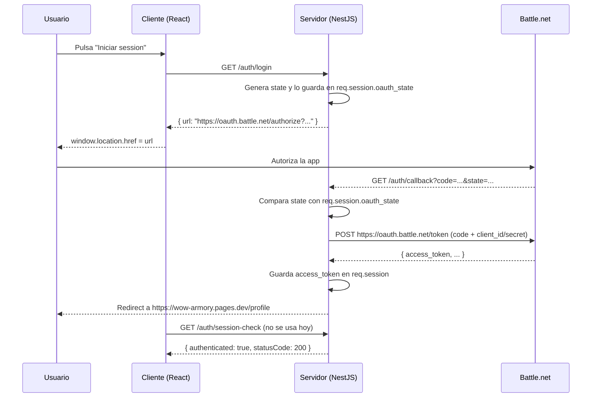

# Contexto de la aplicación — wow-armory

> Documento de contexto para la fábrica de software.
> Última actualización: 2026-11-06.
> Fuente: inspección directa de `wow-armory-server/`, `wow-armory-client/`,
> `AGENTS.md`, `backlog.md` y el historial de Git.

## 1. Resumen ejecutivo

`wow-armory` es una aplicación web para consultar personajes de World of
Warcraft. Se compone de dos proyectos independientes dentro del mismo
repositorio:

- **`wow-armory-server/`**: API REST con NestJS 10 y TypeScript. Expone el
  login OAuth 2.0 con Battle.net (Blizzard), el callback, la verificación de
  sesión, el logout y un endpoint para obtener un personaje desde la API de
  Blizzard.
- **`wow-armory-client/`**: SPA con React 18, Vite 5, TypeScript y Tailwind
  CSS. Muestra una ficha de personaje con banner, estadísticas, logros,
  guild y un selector de tema claro/oscuro.

El estado actual es de **prototipo**: la UI funciona con datos mock, el flujo
de autenticación está a medio conectar y la llamada real a Blizzard no llega a
pintarse en pantalla. El objetivo declarado es evolucionar hacia **arquitectura
hexagonal + DDD** en back y front, y **arreglar la autenticación con
Battle.net**.

## 2. Objetivo del producto

Permitir que un jugador de World of Warcraft:

1. Inicie sesión con su cuenta de Battle.net de forma segura.
2. Busque un personaje por reino y nombre.
3. Vea su ficha real (nivel, clase, raza, especialización, equipo,
   estadísticas, guild y logros recientes).
4. Mantenga la sesión y cierre sesión cuando quiera.

El producto está desplegado (o pensado para desplegarse) con el cliente en
Cloudflare Pages y el servidor en Render.

## 3. Estructura del repositorio

```text
wow-armory/
├── AGENTS.md                  # Contexto y convenciones para agentes
├── backlog.md                 # Cola de features de la fábrica
├── BUILD_PROMT.md             # Diseño de la fábrica de software
├── docs/                      # Documentación de contexto (este documento)
├── factory/                   # board.json + dashboard.html de la fábrica
├── jobs/                      # Artefactos por job de la fábrica
├── .claude/                   # Subagentes, comando /factory y skill del orquestador
├── CLAUDE.md                  # Importa AGENTS.md para Claude Code
├── wow-armory-server/         # API NestJS
│   ├── src/
│   │   ├── main.ts            # Bootstrap: sesión, cookies, CORS, dotenv
│   │   ├── app.module.ts
│   │   ├── app.controller.ts
│   │   ├── app.service.ts
│   │   └── auth/
│   │       ├── auth.module.ts
│   │       ├── auth.controller.ts
│   │       └── auth.service.ts
│   └── test/
└── wow-armory-client/         # SPA React + Vite
    ├── src/
    │   ├── App.tsx
    │   ├── components/        # Header, CharacterBanner, CharacterCard, etc.
    │   ├── hooks/             # useAuth, useDetails
    │   ├── data/              # mockCharacter
    │   └── types/             # Character, Achievement, Guild, CharacterStats
    └── .env                   # VITE_SERVER_URI (trackeado en Git)
```

No hay workspace raíz ni scripts compartidos: cada proyecto se instala y se
ejecuta por separado.

## 4. Stack y dependencias principales

| Capa | Tecnología |
| --- | --- |
| Servidor | NestJS 10, TypeScript 5, Express, `express-session`, `cookie-parser`, `axios`, `dotenv`, `passport`/`passport-oauth2` (instalados pero no usados) |
| Cliente | React 18, Vite 5, TypeScript 5, Tailwind CSS 3, `framer-motion`, `lucide-react`, `axios` |
| Autenticación | OAuth 2.0 Authorization Code contra Battle.net |
| API externa | Blizzard Profile API (`https://us.api.blizzard.com`) |
| Despliegue previsto | Cliente en Cloudflare Pages (`wow-armory.pages.dev`), servidor en Render (`wow-armory.onrender.com`) |
| Tests | Servidor: Jest + Supertest (solo boilerplate). Cliente: sin test runner |
| Calidad | ESLint + Prettier en ambos proyectos |

## 5. Arquitectura actual

### 5.1 Servidor

La API es un proyecto NestJS mínimo con dos módulos:

- `AppModule` → `AppController` + `AppService` (solo `GET /` con
  `Hello World!`).
- `AuthModule` → `AuthController` + `AuthService`.

`main.ts` concentra toda la infraestructura transversal:

- Carga `.env` con `dotenv`.
- Configura `express-session` con `MemoryStore`, cookie `wow_session`,
  `httpOnly`, `sameSite: 'none'` y `secure` solo en producción.
- Configura `cookie-parser`.
- Configura CORS con orígenes hardcodeados
  (`https://wow-armory.pages.dev` y `http://localhost:5173`) y
  `credentials: true`.
- Escucha en `process.env.PORT || 3000`.

`AuthService`:

- Lee `BLIZZARD_CLIENT_ID`, `BLIZZARD_CLIENT_SECRET` y
  `BLIZZARD_REDIRECT_URI` de `process.env` en propiedades de clase.
- `getAccessToken(code)`: `POST https://oauth.battle.net/token` con
  `grant_type=authorization_code`.
- `getCharacterData(realmSlug, characterName, accessToken)`: `GET` a
  `https://us.api.blizzard.com/profile/wow/character/{realm}/{name}` con
  `namespace=profile-classic-us` y `locale=en_US`.
- `checkToken(token)`: llama a `https://oauth.battle.net/oauth/check_token`
  (no se usa y probablemente está incompleto).

No hay capa de dominio, casos de uso, DTOs, validación, puertos ni adaptadores:
el controlador orquesta directamente y el servicio mezcla cliente HTTP,
configuración y lógica de negocio.

### 5.2 Cliente

La SPA es una única página (`App.tsx`) sin router. El estado principal es:

- `darkMode` local en `App`.
- `useAuth()`: hook que consulta `${VITE_SERVER_URI}/auth/login` al montar y
  deduce `isAuthenticated` del `status === 200`.
- `useDetail(url)`: hook genérico de fetch con `axios`, `AbortController`,
  `data`, `isLoading` e `isError`. Lee un token de `document.cookie`
  (`accessToken`) y lo envía como `Authorization: Bearer`.
- `mockCharacter`: objeto `Character` con datos inventados de Thrall.

Los componentes (`Header`, `CharacterBanner`, `CharacterCard`,
`RecentAchievements`, `StatBar`, `Footer`, `ThemeToggle`) consumen el modelo
`Character` definido en `src/types/character.ts`. La UI pinta siempre
`mockCharacter`; el resultado de `useDetail` solo se imprime por consola.

El botón "Iniciar session" del `Header` llama directamente a
`https://wow-armory.onrender.com/auth/login` (URL hardcodeada, distinta de la
variable de entorno) y redirige a la URL de autorización que devuelve el
servidor.

### 5.3 Integración y despliegue

```text
Navegador (localhost:5173 / wow-armory.pages.dev)
        │
        │ fetch /auth/login, /auth/callback, /auth/character/..., etc.
        ▼
Servidor NestJS (localhost:3000 / wow-armory.onrender.com)
        │
        │ OAuth 2.0 + Profile API
        ▼
Battle.net / Blizzard API
```

El cliente y el servidor viven en dominios distintos, por lo que la sesión es
una cookie cross-site. En producción se fuerza `sameSite: 'none'` +
`secure: true` y un `domain` `.onrender.com`. Esto es frágil: los navegadores
están bloqueando cada vez más las cookies de terceros, y `.onrender.com` es un
dominio compartido, no el dominio del cliente.

## 6. Flujo de autenticación actual



### Endpoints actuales

| Método | Ruta | Estado | Descripción |
| --- | --- | --- | --- |
| `GET` | `/` | OK | `Hello World!` |
| `GET` | `/auth/login` | Parcial | Devuelve la URL de autorización. No redirige. |
| `GET` | `/auth/callback` | Parcial | Valida `state`, canjea el código, guarda el token y redirige a Pages. |
| `GET` | `/auth/session-check` | OK pero sin uso | Devuelve `{ authenticated, statusCode }`. |
| `GET` | `/auth/character/:realmSlug/:characterName` | Roto en la práctica | Exige `req.session.access_token` y llama a Blizzard. |
| `GET` | `/auth/logout` | Sin UI | Destruye la sesión. |

### Problemas concretos del flujo actual

1. **`useAuth` llama a `/auth/login`, no a `/auth/session-check`.** Como
   `/auth/login` siempre responde `200` con una URL, `isAuthenticated` pasa a
   `true` en cuanto monta la app, aunque el usuario no haya iniciado sesión.
2. **El cliente busca una cookie `accessToken` que no existe.** El servidor
   guarda el token en la sesión (`wow_session`, `httpOnly`). JavaScript no
   puede leerla y, además, el nombre no coincide. `useDetail` siempre termina
   en "Token de acceso no encontrado".
3. **El cliente envía `Authorization: Bearer` pero el servidor lo ignora.** El
   endpoint de personaje lee `req.session.access_token`, no la cabecera.
4. **La URL del personaje está hardcodeada** (`grobbulus/billiemoi`) y se
   ejecuta al montar, antes de que exista una sesión.
5. **El `state` no se consume ni expira.** Se compara una vez, pero no se
   borra de la sesión después del callback.
6. **No se regenera la sesión tras el login**, lo que deja abierta la puerta a
   session fixation.
7. **El redirect del callback está hardcodeado** a
   `https://wow-armory.pages.dev/profile`; en local redirige a producción.
8. **El cliente no tiene ruta `/profile` ni `/error`** (no hay router), así
   que los redirects de producción pueden acabar en 404.
9. **No se manejan errores de OAuth** (`?error=access_denied`, etc.) ni se
   leen `refresh_token`/`expires_in`.
10. **`BLIZZARD_REDIRECT_URI` debe coincidir exactamente** con la configurada
    en Battle.net; si falta, el login falla sin un error claro.

## 7. Modelo de datos

### 7.1 Respuesta cruda de Blizzard

`getCharacterData` devuelve el JSON tal cual de Blizzard. La forma real es
anidada y mucho más rica que el modelo del cliente, por ejemplo:

```jsonc
{
  "character": {
    "name": "Billiemoi",
    "level": 70,
    "realm": { "slug": "grobbulus", "name": "Grobbulus" },
    "class": { "name": "Shaman" },
    "race": { "name": "Orc" },
    "active_spec": { "name": "Enhancement" },
    "equipped_item_level": 447,
    "achievement_points": 12345,
    "last_login_timestamp": 1710000000000
  },
  "guild": { "name": "...", "realm": { "name": "..." } },
  "achievements": { "recent_events": [] }
}
```

### 7.2 Modelo del cliente

`src/types/character.ts` define un modelo plano y orientado a la UI
(`Character`, `CharacterStats`, `Guild`, `Achievement`) y
`src/data/mockCharacter.ts` lo rellena con datos ficticios. **No existe un
mapper entre la respuesta de Blizzard y este modelo.** Esa es una de las
razones por las que los datos reales no se pintan.

### 7.3 Brecha

| Necesidad | Estado |
| --- | --- |
| Contrato de API estable (DTO de salida) | No existe |
| Modelo de dominio del personaje | No existe |
| Mapper Blizzard → dominio → UI | No existe |
| Validación de entrada (`realmSlug`, `characterName`) | No existe |
| Manejo de errores tipado (401/404/429/5xx) | No existe |

## 8. Configuración y entornos

### Variables de entorno del servidor

| Variable | Uso | Estado |
| --- | --- | --- |
| `BLIZZARD_CLIENT_ID` | Client ID de Battle.net | Requerida |
| `BLIZZARD_CLIENT_SECRET` | Client Secret de Battle.net | Requerida |
| `BLIZZARD_REDIRECT_URI` | URL de callback registrada | Requerida |
| `SESSION_SECRET` | Firma de la cookie de sesión | Obligatoria en producción (hoy hay fallback inseguro) |
| `PORT` | Puerto del servidor | Opcional (3000) |
| `NODE_ENV` | Activa `secure` en cookies | Opcional |

No hay `.env.example` en el servidor. El `.env` del servidor está ignorado por
Git (correcto). El `.env` del cliente **sí está trackeado**; hoy solo contiene
`VITE_SERVER_URI`, pero conviene sustituirlo por `.env.example`.

### Variables de entorno del cliente

| Variable | Uso |
| --- | --- |
| `VITE_SERVER_URI` | Base URL del servidor NestJS |

## 9. Comandos

### Servidor (`wow-armory-server/`)

```bash
npm install
npm run start:dev        # desarrollo
npm test -- --runInBand  # unitarios
npm run test:e2e         # e2e
npm run lint
npm run build
```

### Cliente (`wow-armory-client/`)

```bash
npm install
npm run dev              # desarrollo en http://localhost:5173
npm run lint
npm run build            # typecheck + build
```

## 10. Estado actual: qué funciona y qué no

| Capacidad | Estado | Evidencia |
| --- | --- | --- |
| Arrancar servidor y cliente | ✅ | Scripts de Nest y Vite |
| Ver ficha de personaje | ⚠️ Solo mock | `App.tsx` usa `mockCharacter` |
| Cambiar tema claro/oscuro | ✅ | `ThemeToggle` + `darkMode` |
| Ver logros recientes | ⚠️ Solo mock | `mockCharacter.recentAchievements` |
| Buscar personaje | ❌ | `SearchBar` solo hace `console.log` |
| Iniciar sesión con Battle.net | ⚠️ Parcial | Devuelve URL y redirige, pero no hay verificación real de sesión |
| Verificar sesión | ⚠️ Endpoint sin uso | `useAuth` consulta `/auth/login` |
| Cargar datos reales del personaje | ❌ | Cookie/token mal conectados y respuesta sin mapear |
| Cerrar sesión | ⚠️ Endpoint sin UI | `GET /auth/logout` |
| Manejar errores de auth | ❌ | No hay ruta `/error` ni lectura de `?error=` |
| Refrescar token | ❌ | No se guarda `refresh_token` |
| Tests de auth | ❌ | Solo boilerplate de Nest |
| Tests de cliente | ❌ | Sin runner configurado |
| Accesibilidad del cliente | ⚠️ | Hay `aria-label` en el toggle; faltan foco, teclado y labels |

## 11. Hallazgos clave

### 11.1 Autenticación

- Mezcla de dos mecanismos: sesión en servidor y supuesto token en cookie de
  cliente. Ninguno de los dos está completo.
- `useAuth` y `Header.login` usan URLs distintas para el mismo backend.
- El callback no consume el `state`, no regenera la sesión, no guarda
  `refresh_token` ni `expires_at`.
- El endpoint de personaje está dentro de `AuthController`; no debería.
- El token de Blizzard caduca (típicamente 24 h) y no hay renovación.
- `checkToken` no se usa y probablemente no funciona tal como está escrito.

### 11.2 Seguridad

- `SESSION_SECRET` tiene un fallback público (`'tu-secreto-temporal'`).
- `MemoryStore` de `express-session` no es apto para producción.
- Cookie cross-site con `sameSite: 'none'` y `domain: '.onrender.com'`:
  frágil y potencialmente rechazada por el navegador.
- CORS hardcodeado; no se puede configurar por entorno.
- Se imprimen tokens y respuestas de Blizzard en logs
  (`useDetails.ts` y `auth.service.ts`).
- No hay validación de `realmSlug`/`characterName` (posible inyección en la
  URL de Blizzard y consumo innecesario de cuota).
- No hay rate limiting en login/callback (ya está en el backlog como
  `003-rate-limiting`).
- El `.env` del cliente está trackeado (hoy sin secretos, pero es un mal
  hábito).

### 11.3 Arquitectura

- Servidor: controlador gordo, servicio que mezcla HTTP + configuración +
  negocio, sin dominio ni puertos.
- Cliente: hooks que mezclan transporte, estado y reglas de UI; componentes
  acoplados a un modelo plano; datos mock dentro de `src/data`.
- No hay separación entre `domain`, `application`, `infrastructure` y
  `presentation`.
- No hay contratos compartidos entre back y front (tipos duplicados a mano).
- No hay router, ni `AuthProvider`, ni manejo centralizado de sesión.

### 11.4 Calidad y tests

- Tests del servidor: solo `AppController` y `AuthService` "should be
  defined". No hay tests del flujo OAuth ni del endpoint de personaje.
- Cliente sin tests. La verificación mínima es `lint && build`.
- Uso de `any` en el servidor (`Promise<any>`, `error: error.message`).
- `console.log` de depuración en producción.

### 11.5 UX/UI

- Texto "Iniciar session" (sin tilde) y estilos de botón fuera del layout del
  header.
- El header mezcla el botón de login con el logo y el buscador sin jerarquía
  clara.
- No hay estados de carga/error/vacío visibles para el usuario.
- No hay feedback al buscar ni al autenticarse.
- `index.html` tiene un comentario suelto (`// return commit`) y el título por
  defecto de Vite.

## 12. Glosario

| Término | Significado |
| --- | --- |
| **Battle.net** | Plataforma de cuentas de Blizzard; proveedor OAuth. |
| **Blizzard API** | API de datos de World of Warcraft (personajes, guilds, etc.). |
| **OAuth 2.0 Authorization Code** | Flujo usado para que el usuario autorice la app sin compartir su contraseña. |
| **`state`** | Valor aleatorio para prevenir CSRF en el callback OAuth. |
| **`realmSlug`** | Identificador del reino en la API (p. ej. `grobbulus`). |
| **`namespace`** | Contexto de datos de Blizzard (retail, classic, classic1x) y región. |
| **Access token** | Token temporal para llamar a la API de Blizzard. |
| **Refresh token** | Token para obtener un nuevo access token sin volver a pedir login. |
| **Bounded context** | Límite explícito de un modelo de dominio (DDD). |
| **Puerto / adaptador** | Interfaz del dominio y su implementación técnica (hexagonal). |
| **Strangler pattern** | Estrategia de migración incremental envolviendo el código legacy. |

## 13. Referencias de código

- Bootstrap y sesión: `wow-armory-server/src/main.ts`
- Módulo y controlador de auth: `wow-armory-server/src/auth/`
- Cliente HTTP de Blizzard: `wow-armory-server/src/auth/auth.service.ts`
- Hooks de auth y fetch: `wow-armory-client/src/hooks/`
- Modelo y mock: `wow-armory-client/src/types/character.ts`,
  `wow-armory-client/src/data/mockCharacter.ts`
- Pantalla principal: `wow-armory-client/src/App.tsx`
- Convenciones y comandos: `AGENTS.md`
- Cola de trabajo: `backlog.md`
